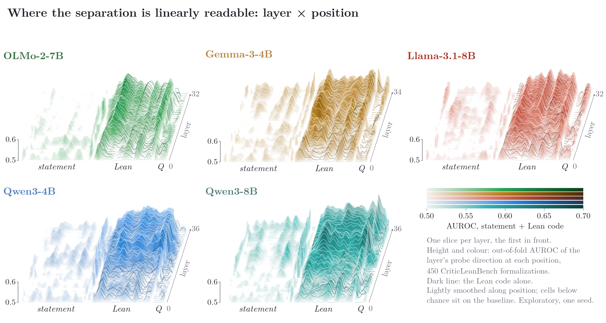

# It Compiles, but Is It What We Meant?

Code, decision rules, data and result files for the preprint

> **It Compiles, but Is It What We Meant? Linear Probes for the Faithfulness of Lean 4 Formalizations**
> Carlos Manuel Orrego-Franco, Juan Carlos Riaño-Rojas, Fabián Fernando Serrano-Suárez.
> Universidad Nacional de Colombia, Manizales.

The paper is in [`paper_adecuacion/v6_retorica/main_en.pdf`](paper_adecuacion/v6_retorica/main_en.pdf). A Spanish version is in [`main_es.pdf`](paper_adecuacion/v6_retorica/main_es.pdf).



*Exploratory maps, one seed. Height and colour show the out-of-fold AUROC of each layer's probe direction, token by token, on the 450 CriticLeanBench formalizations. The dark line is the Lean code alone.*

## Status: the central gap has been cross-checked, the rest is preliminary

Every number in the paper and in this repository comes from the reference implementation, which was written with AI coding assistants under rules set by the first author. By the rule of the project, these numbers become findings only after they are compared with an implementation the first author writes by hand ([`probes/probe.py`](probes/probe.py)).

That comparison has been run for the central gap, the AUROC of the probe that reads the statement with the Lean code minus that of the probe that reads the Lean code alone. It covers Level A, in the eight models and under both readouts, and Level C, in the two models. The two implementations, the one written with AI assistants and the one written by hand, agree. In all 18 comparisons both AUROCs and the gap lie within 0.005 of each other, and the largest difference is 0.003. A difference of that size shows in one place only. In Qwen3-8B under readout (i), an exploratory model, it moves the lower end of the interval from −0.004 to 0.002.

Two things bound that agreement. At Level C the two implementations call the same solver, so their identical scores check the folds and the choice of layer, and they do not check the numerical fit. `probe.py` also computes no permutation test, no control and no paired AUROC, so the preregistered decision, the controls of every level and all of Level B remain preliminary.

An AI assistant executed `probe.py`, unchanged, under a decision rule written to the project log before the runs. The full tables are in [`probes/resultados_probe_todo_2026-11-22.md`](probes/resultados_probe_todo_2026-11-22.md) and [`probes/resultados_probe_2026-11-21.md`](probes/resultados_probe_2026-11-21.md) (in Spanish).

Two more items are pending. A blind human review of 80 items is in progress, and the protocol for the confirmatory test is an unsigned draft. Neither is published here.

## The question

A Lean formalization can compile and still say something other than the statement it was meant to capture. We ask whether the activations of frozen language models linearly separate faithful from unfaithful Lean 4 formalizations beyond what the Lean code alone gives away. At three levels we measure the AUROC gap between a linear probe that reads the statement with the formalization and one that reads the formalization alone.

No level alone supports the claim that faithfulness is linearly decodable from frozen models beyond the Lean code alone.

- **Level A, CriticLeanBench.** On 450 formalizations a preregistered replication did not pass, because none of its four models met the per-model criterion. A post hoc bootstrap puts their mean gap at +0.045 (95% CI [0.021, 0.069]) at a fixed layer, which means the probe that reads the statement orders 4 to 5 more pairs correctly out of every 100. At the last token the interval includes zero.
- **Level B, minimal pairs.** On 377 pairs certified by Lean, exploratory runs gave a positive gap in three of four models at the last token. Against the stronger of two surface controls, only one keeps a margin whose interval excludes zero.
- **Intervention on the Level B pairs.** Shifting activations along the difference of class means changes the model's answer more than any of 20 random directions does in two of four models. One is OLMo-2, under a rule fixed in advance, and the other is Qwen3-4B, in a post hoc run, so under a rule fixed in advance the shift meets its criterion in one model of three. Twenty random directions are a small control for a residual stream of thousands of dimensions. An earlier ablation in Qwen3-4B, along a different direction, gave a null. The shift shows that moving that axis is enough to change the answer. It does not show that the model relies on it.
- **Level C, ProofNetVerif.** The gap was positive in two models, one of them exploratory.

"Preregistered" here means a written decision rule with a recorded SHA-256 and approval time, kept in the project log. These rules are internal files. They are not entries in a public registry.

## What is here

| Path | Contents |
|---|---|
| `paper_adecuacion/v6_retorica/` | The current version of the paper: LaTeX sources and PDFs in English and Spanish, and the figures with the scripts that draw them (`figuras_v5/`) |
| `paper_adecuacion/fuentes/`, `paper_adecuacion/figuras/datos/` | Result files read by the figure scripts |
| `probes/prerregistro_v2.md`, `probes/prerregistros/` | Level A preregistration and its hashed copy |
| `probes/*/APROBADO_*`, `probes/*/regla_*.md` | Decision rules of each level with their hashes and approval times, unedited |
| `probes/referencia/` | Reference implementation of Level A and its results |
| `probes/probe.py`, `probes/resultados_probe_*.md`, `probes/corrida_probe_*/` | The first author's implementation of the probes, the two reports of its comparison with the reference (Qwen3-4B on 22 November; Levels A and C in full that night), and the scripts, logs and scores of those runs |
| `probes/nivel_b/` | Generator, Lean certification, the certified pairs (`datos/`, `certificacion/`), surface controls and results of Level B |
| `probes/intervencion/` | Intervention rules, code and results |
| `probes/nivel_c/` | Level C code, data and results, including the second, independent implementation |
| `probes/sin_pregunta/` | Code and results of the prompt-without-question control |
| `probes/BITACORA.md` | The project log, with the numbered list of deviations and late decisions |

Most working files are in Spanish. The paths `/Users/cmorregof/...` that appear in logs and in some rules are those of the machine where the runs were made. They were left as they are because the signed rules are not edited.

## What is not here

- **Activations.** The extracted residual-stream activations take about 37 GB and are not published. Without them the probes cannot be refitted. `probes/extraer.py` and the per-level extraction scripts regenerate them from the pinned model revisions listed in the paper's appendix.
- **Probe directions of the intervention** (`direcciones.npz`, about 200 MB).
- **CriticLeanBench.** The benchmark is not redistributed. It is available from its authors at <https://huggingface.co/datasets/m-a-p/CriticLeanBench>.
- **Intermediate candidate files** of the Level B generator, and working material that the paper does not cite.

## Checking and compiling the text

`coteja_en_es.py` checks that the English and Spanish sources carry the same numbers in the same order. From a clean clone, with Python 3 and no extra packages:

```bash
cd paper_adecuacion/v6_retorica
python3 coteja_en_es.py main_en.tex main_es.tex
```

`latexmk -pdf main_en.tex` and `latexmk -pdf main_es.tex` compile the two PDFs. `ejemplos_nivel_b.py` also needs `pyarrow`.

The figure scripts in `figuras_v5/` need `numpy`, `matplotlib`, `tueplots` and `colorspacious`. `figuras_v5.py` and `fig_intervencion.py` also need LaTeX with `lmodern` and `cm-super`.

Earlier versions of the text (`v4_voz/`, `v5_causal/`) were removed from the working tree on 22 November 2026. They remain in the git history, together with the scripts that built one version from the previous one and checked each number of the edited passages against a result file (`aplica_v5.py`, `verifica_v5.py`). The current version changes the order and the prose of `v5_causal/` and none of its numbers.

## Licenses and sources

The code is under the MIT License ([`LICENSE`](LICENSE)). The data, the result files and the text are under CC BY 4.0 ([`LICENSE-DATA.md`](LICENSE-DATA.md)). [`NOTICE.md`](NOTICE.md) lists the sources of the derived data and their licenses.

## Contact

Carlos Manuel Orrego-Franco, Universidad Nacional de Colombia, Manizales.
