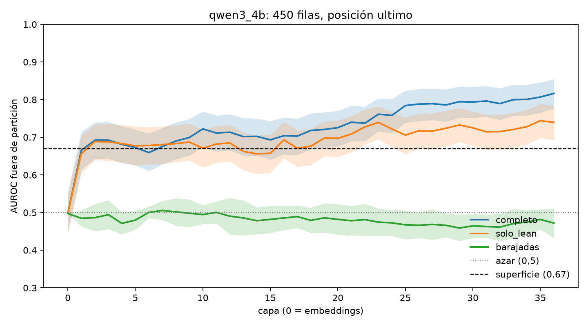
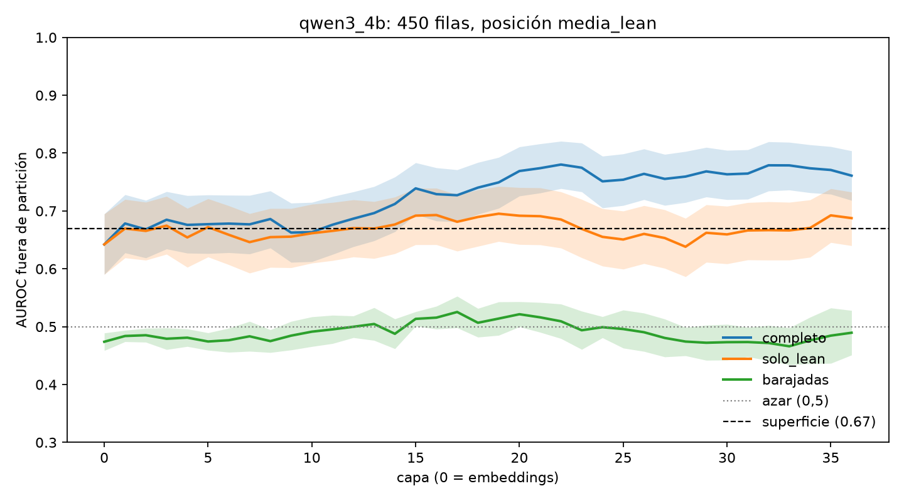
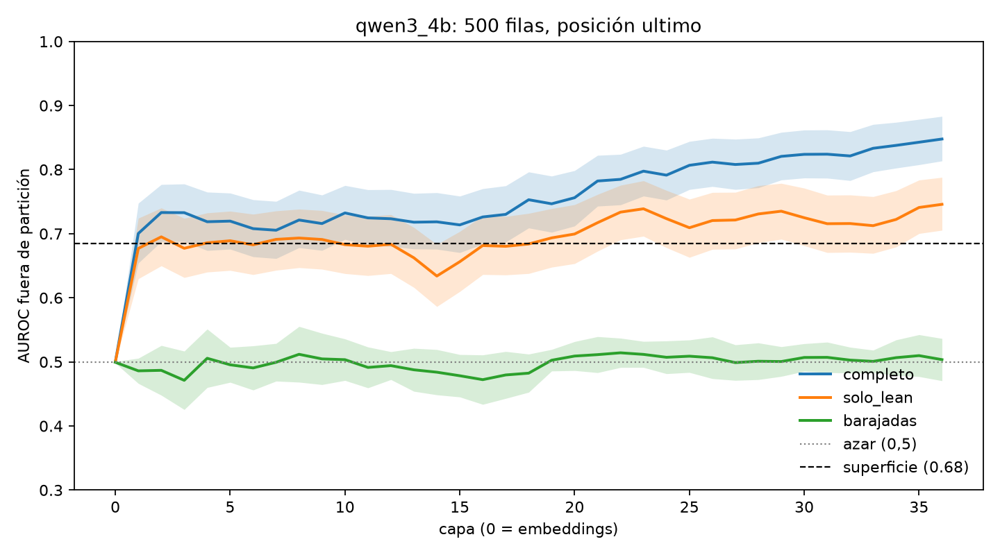
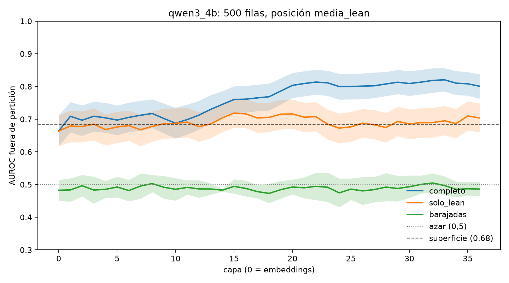

# Resultados de probes lineales (2026-11-22)

Semillas: [0, 1, 2, 3, 4] (puntajes fuera de partición promediados). Bootstrap: 2000 remuestreos estratificados por clase. Carpeta: `qwen3_4b`.

```json
{
  "fecha": "2026-11-04 13:10 -05",
  "modelo": "Qwen/Qwen3-4B",
  "revision": "1cfa9a7208912126459214e8b04321603b3df60c",
  "dtype_modelo": "bfloat16",
  "dtype_activaciones": "float16",
  "dispositivo": "mps",
  "n_filas": 500,
  "n_capas_mas_embeddings": 37,
  "d_modelo": 2560,
  "plantilla_chat": true,
  "enable_thinking": false,
  "plantilla_completo": "Natural-language statement:\n{nl}\n\nLean 4 formalization:\n```lean\n{lean}\n```\n\nIs this formalization faithful? Answer Yes or No.",
  "plantilla_solo_lean": "Lean 4 formalization:\n```lean\n{lean}\n```\n\nIs this formalization faithful? Answer Yes or No.",
  "plantilla_solo_nl": "Natural-language statement:\n{nl}\n\nIs this formalization faithful? Answer Yes or No.",
  "nl_desemparejado": {
    "semilla": 0,
    "bandas": 5,
    "criterio": "quintiles de longitud del NL en caracteres; desarreglo dentro de cada banda; nunca el mismo grupo (NL normalizado)"
  },
  "ids_yes_no": {
    "Yes": 9454,
    "No": 2753,
    " Yes": 7414,
    " No": 2308
  },
  "prefijo_respuesta": "**Answer:",
  "columnas_pyes": [
    "p_yes",
    "p_no",
    "logit_yes",
    "logit_no",
    "p_yes_prefijo",
    "p_no_prefijo",
    "logit_yes_prefijo",
    "logit_no_prefijo"
  ],
  "posiciones": {
    "completo": [
      "ultimo",
      "media_lean"
    ],
    "solo_lean": [
      "ultimo",
      "media_lean"
    ],
    "solo_nl": [
      "ultimo",
      "media_nl"
    ],
    "nl_desemparejado": [
      "ultimo",
      "media_lean"
    ]
  },
  "variantes_completas": [
    "completo",
    "solo_lean",
    "solo_nl",
    "nl_desemparejado"
  ],
  "etiqueta": "1 = compile_right_is_right (adecuada, etiqueta humana de CriticLeanBench); 0 = resto",
  "dataset": "m-a-p/CriticLeanBench@6225522bce304f62d4907aedb9642255f9417bf0",
  "dataset_sha256": "baf3e43bcfe0c476114e744b7cde098fe02292a5ab9b0b0fa84dc279f1e203d3",
  "versiones": {
    "python": "3.13.13",
    "torch": "2.14.1",
    "transformers": "5.19.0",
    "numpy": "2.5.4",
    "macos": "26.5.2"
  },
  "corridas": [
    {
      "fecha": "2026-11-04 11:00 -05",
      "variantes": [
        "completo",
        "solo_lean"
      ],
      "segundos_por_pase_media": 0.815,
      "memoria_driver_mps_gib_pico": 10.8
    },
    {
      "fecha": "2026-11-04 13:10 -05",
      "variantes": [
        "solo_nl",
        "nl_desemparejado"
      ],
      "pases": 1000,
      "segundos_carga": 4.3,
      "segundos_por_pase_media": 0.735,
      "segundos_totales_pases": 734.5,
      "memoria_driver_mps_gib_pico": 8.8
    }
  ]
}
```

## 450 filas, posición ultimo (análisis principal; lectura (i), capa anidada)

| Medida | AUROC [IC 95 %] | Nota |
|---|---|---|
| Probe completo | 0.811 [0.771, 0.849] | capas elegidas por semilla: [[36, 36, 26, 36, 36], [36, 36, 36, 36, 36], [36, 36, 23, 36, 36], [36, 36, 36, 36, 36], [36, 36, 36, 36, 36]] |
| Probe solo_lean | 0.723 [0.677, 0.767] | capas elegidas por semilla: [[36, 23, 35, 3, 36], [23, 36, 29, 35, 23], [3, 23, 36, 22, 23], [22, 23, 16, 36, 35], [35, 2, 23, 35, 36]] |
| Diferencia pareada (completo - solo_lean) | 0.088 [0.041, 0.135] | prueba central |
| Superficie (unigramas y bigramas + longitud) | 0.670 [0.621, 0.719] | sin activaciones |
| P(Yes) completo | 0.699 [0.653, 0.745] | masa media 1.000 |
| P(Yes) solo_lean | 0.637 [0.585, 0.688] | masa media 1.000 |
| Barajadas, máximo entre capas | 0.506 | debe rondar 0,5 |
| Mejor capa completo (descriptivo) | 0.816 [0.777, 0.854] | capa 36; optimista |
| Mejor capa solo_lean (descriptivo) | 0.744 [0.698, 0.789] | capa 35; optimista |

El probe con el prompt completo separa más allá del Lean (IC del 95 % sobre 0).



## 450 filas, posición media_lean (secundario; lectura (ii), capa fija 24)

| Medida | AUROC [IC 95 %] | Nota |
|---|---|---|
| Probe completo | 0.751 [0.705, 0.795] | sin selección |
| Probe solo_lean | 0.655 [0.605, 0.704] | sin selección |
| Diferencia pareada (completo - solo_lean) | 0.096 [0.055, 0.135] | prueba central |
| Superficie (unigramas y bigramas + longitud) | 0.670 [0.621, 0.719] | sin activaciones |
| P(Yes) completo | 0.699 [0.653, 0.745] | masa media 1.000 |
| P(Yes) solo_lean | 0.637 [0.585, 0.688] | masa media 1.000 |
| Barajadas, máximo entre capas | 0.525 | debe rondar 0,5 |
| Mejor capa completo (descriptivo) | 0.780 [0.739, 0.821] | capa 22; optimista |
| Mejor capa solo_lean (descriptivo) | 0.695 [0.647, 0.743] | capa 19; optimista |

El probe con el prompt completo separa más allá del Lean (IC del 95 % sobre 0).



## 500 filas, posición ultimo (secundario; lectura (i), capa anidada)

| Medida | AUROC [IC 95 %] | Nota |
|---|---|---|
| Probe completo | 0.842 [0.807, 0.878] | capas elegidas por semilla: [[36, 36, 33, 36, 36], [36, 36, 36, 36, 36], [36, 36, 36, 36, 30], [29, 36, 33, 36, 36], [30, 36, 36, 36, 36]] |
| Probe solo_lean | 0.730 [0.687, 0.775] | capas elegidas por semilla: [[22, 22, 26, 35, 23], [28, 36, 35, 23, 22], [35, 36, 36, 21, 28], [23, 35, 36, 29, 35], [23, 36, 35, 22, 35]] |
| Diferencia pareada (completo - solo_lean) | 0.112 [0.069, 0.155] | prueba central |
| Superficie (unigramas y bigramas + longitud) | 0.684 [0.638, 0.733] | sin activaciones |
| P(Yes) completo | 0.728 [0.683, 0.772] | masa media 1.000 |
| P(Yes) solo_lean | 0.660 [0.615, 0.708] | masa media 1.000 |
| Barajadas, máximo entre capas | 0.514 | debe rondar 0,5 |
| Mejor capa completo (descriptivo) | 0.848 [0.814, 0.883] | capa 36; optimista |
| Mejor capa solo_lean (descriptivo) | 0.746 [0.705, 0.788] | capa 36; optimista |

El probe con el prompt completo separa más allá del Lean (IC del 95 % sobre 0).



## 500 filas, posición media_lean (secundario; lectura (ii), capa fija 24)

| Medida | AUROC [IC 95 %] | Nota |
|---|---|---|
| Probe completo | 0.800 [0.760, 0.839] | sin selección |
| Probe solo_lean | 0.673 [0.626, 0.718] | sin selección |
| Diferencia pareada (completo - solo_lean) | 0.127 [0.091, 0.163] | prueba central |
| Superficie (unigramas y bigramas + longitud) | 0.684 [0.638, 0.733] | sin activaciones |
| P(Yes) completo | 0.728 [0.683, 0.772] | masa media 1.000 |
| P(Yes) solo_lean | 0.660 [0.615, 0.708] | masa media 1.000 |
| Barajadas, máximo entre capas | 0.505 | debe rondar 0,5 |
| Mejor capa completo (descriptivo) | 0.820 [0.784, 0.856] | capa 33; optimista |
| Mejor capa solo_lean (descriptivo) | 0.719 [0.674, 0.765] | capa 15; optimista |

El probe con el prompt completo separa más allá del Lean (IC del 95 % sobre 0).


